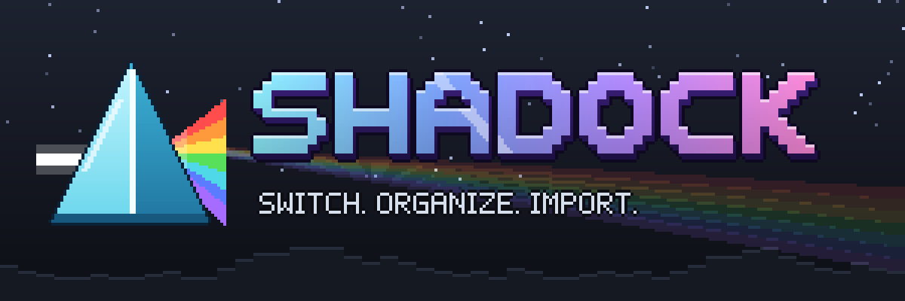

<p align="center"></p>

# Shadock

A fast, vanilla-styled shader dock for **Iris** on **Minecraft 26.3 (Fabric)**. Press **H**, click a shader. Drag to reorder, **+** to import.

## Build

Requires a JDK 21 to start Gradle. The build then provisions Java 25 on its own.

```bash
gradlew build
```

The jar is written to `build/libs/shadock-<version>.jar`.

## Run and test

| Task | What it does |
|---|---|
| `gradlew runClient` | Dev client with Iris and Sodium. Test shader packs go in `run/shaderpacks`. |
| `gradlew test` | Unit tests: import, validation, ordering, config and scanner. |
| `gradlew runClientGameTest` | Automated in-game test. It opens the dock, applies real packs, drags a row, opens settings, and saves release screenshots to `build/run/clientGameTest/shadock-screenshots`. It needs ZIPs in `run/shaderpacks`. |
| `python tools/make_assets.py [preview.png]` | Regenerates all 32x art and the branding (needs Pillow and numpy). |

## Layout

- `src/main/java/dev/shadock/shadock/iris/`: the **only** code that touches Iris, behind `IrisCompat`, pinned to Iris 1.11.7.
- `shader/`: scanning, validation, importing and ordering (pure Java, unit-tested).
- `ui/`: the dock screen, list widget, buttons and settings.
- `tools/`: the asset generator. All artwork is original.
- `SPEC.md`: the full specification. `TESTING.md`: the manual test checklist.

## License

MIT, © 2026 whynotdhyan. See `LICENSE`.

## Support

[](https://buymeacoffee.com/whynotdhyan)
