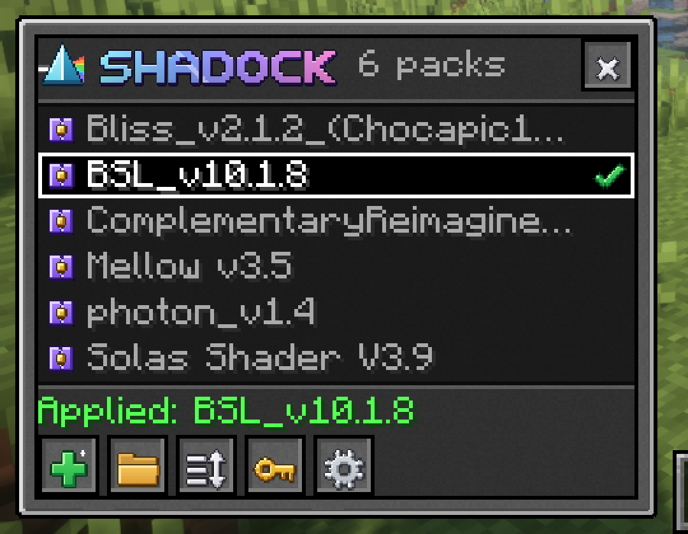

<!--
  README OUTLINE: write the prose yourself, in your own words. Delete these notes as you go.
  Tone: telling another modder about it, not selling it. Contractions, no emoji, no badge row.
-->

# Shadock

<!-- 1-2 sentences, your words: what it does and the annoyance it fixes
     (switching Iris packs means opening the full shader menu, finding the pack, applying, closing).
     No adjectives. -->

<!-- One line on requirements, a flat fact:
     Fabric Loader 0.20.1+, Fabric API, Iris 1.11.7, Minecraft 26.3, Java 25. Client only.
     Then one line on other versions. Older ports are planned (docs/PORTING_PLAN.md);
     say it plainly, e.g. depends on demand / in progress. -->

## What's in it
<!-- 4-8 concrete bullets, facts only:
     - H opens it (rebindable, why not O: 26.3 uses O for Friends)
     - click a pack to switch, clicking the active one does nothing
     - drag to reorder, saved to config; A-Z mode turns dragging off
     - + imports a zip via the system file picker, checks it's really a shader pack,
       Replace / Keep Both / Cancel on name clash
     - arrow keys + Enter, 1-9 for the first nine rows
     - shows Iris's own error when a pack fails to load -->

## Install
<!-- Drop the jar in mods/. Link the CurseForge page:
     https://www.curseforge.com/minecraft/mc-mods/shadock
     Builds from anywhere else are unofficial. -->

## Config
<!-- config/shadock/shadock.json, created on first run, editable from the gear button in the dock.
     One line per key:
     sortMode (CUSTOM_ORDER / ALPHABETICAL), autoHideDelaySeconds (0 = never, 3, 5, 10),
     dockAnimation, duplicateImportBehavior (ASK / REPLACE / KEEP_BOTH / CANCEL), customPackOrder.
     Changes from the gear screen apply immediately; hand edits need a restart.
     NOTE: re-check this section after you rewrite the config loader. -->

## Building

    ./gradlew build              # jar lands in build/libs
    ./gradlew runClient          # dev client, put shader zips in run/shaderpacks
    ./gradlew runClientGameTest  # automated in-game run + screenshots

<!-- one line: Gradle needs a JDK 21+ to start, it fetches Java 25 itself -->

## Compatibility
<!-- Real table. Only list what you've actually checked.
| Mod | Status |
|---|---|
| Iris 1.11.7 | required, the only tested version |
| Sodium | needed by Iris anyway |
| other Iris versions | refused at startup with a "not supported" message, on purpose | -->

## Credits
<!-- Iris and Sodium teams. Vanilla GUI sprites referenced for colors/shapes.
     Icon: you (once you've redrawn it). -->

## AI disclosure
<!-- PLACEHOLDER. Write this last, after your own rewrites (icon, README, config loader, tick path),
     and describe what actually ended up hand-made. Be specific; specifics are what people can check. -->

## License
MIT, see [LICENSE](LICENSE).
